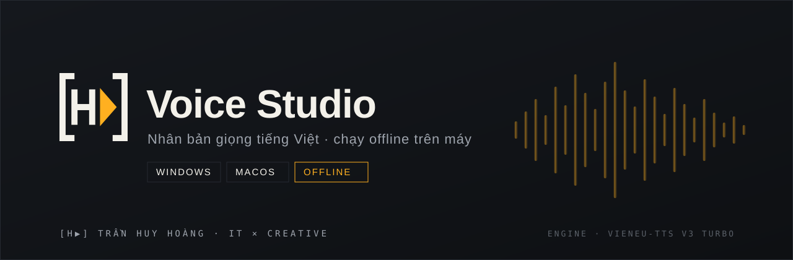

  
  
  
  

<h3 align="center">Ghi vài giây giọng nói — đọc mọi văn bản bằng chính giọng của bạn.</h3>

Chạy hoàn toàn trên máy tính · Không gửi dữ liệu ra ngoài · Không cần tài khoản

<a href="https://github.com/TranHoang004/voice-studio/releases/latest"><b>⬇&nbsp; Tải Voice Studio</b></a>

---

## Tính năng

| | |
|---|---|
| 🎙️ **Tạo giọng trong vài giây** | Ghi âm trực tiếp hoặc dùng file có sẵn — Voice Studio tự chọn đoạn rõ nhất để làm mẫu. |
| 📝 **Đọc văn bản dài** | Dán bài viết, kịch bản hay cả chương sách; ứng dụng tự chia đoạn và ghép lại liền mạch. |
| 😄 **Biểu cảm tự nhiên** | Chèn [cười], [thở dài], [hắng giọng] ngay trong văn bản. |
| ✂️ **Chỉnh từng đoạn** | Đoạn nào chưa ưng thì đọc lại riêng đoạn đó. |
| 📚 **Thư viện** | Mọi bản đọc được lưu lại để nghe, tải về, đổi tên hoặc dùng lại kịch bản. |
| 🔒 **Riêng tư** | Giọng nói và văn bản chỉ được xử lý trên máy của bạn. |
| 🔄 **Tự cập nhật** | Khi có phiên bản mới, ứng dụng thông báo và cập nhật chỉ với một lần bấm. |

## Cài đặt

**1.** Mở trang **[phiên bản mới nhất](https://github.com/TranHoang004/voice-studio/releases/latest)** và tải file phù hợp với máy:

| Hệ điều hành | File cài đặt |
|---|---|
| Windows 10 / 11 (64-bit) | `VoiceStudio-Setup-…exe` |
| macOS 12 trở lên, chip Apple M1 – M4 | `VoiceStudio-…pkg` |

**2.** Mở file vừa tải và làm theo hướng dẫn trên màn hình.

**3.** Lần đầu cài cần Internet để tải dữ liệu giọng đọc (khoảng 600 MB). Sau đó Voice Studio dùng được không cần mạng.

> [!NOTE]
> Nếu máy hiện cảnh báo khi mở file cài:
> - **Windows:** chọn **More info → Run anyway**.
> - **macOS:** nhấn chuột phải vào file → **Open**, hoặc vào System Settings › Privacy & Security › **Open Anyway**.

## Yêu cầu hệ thống

- Windows 10 / 11 (64-bit), hoặc macOS 12 trở lên với chip Apple Silicon
- Còn trống khoảng 4 GB ổ đĩa
- Micro, nếu muốn ghi âm trực tiếp

## Gỡ cài đặt

- **Windows:** Settings › Apps › Voice Studio › Uninstall
- **macOS:** mở Voice Studio › tab **Tình trạng** › **Gỡ cài đặt**

Bạn có thể chọn giữ lại các file giọng đọc đã tạo.

## Sử dụng có trách nhiệm

Chỉ nhân bản giọng của chính bạn hoặc của người đã đồng ý. Không dùng Voice Studio để mạo danh, lừa đảo hay gây hiểu lầm.

## Ghi nhận

Voice Studio sử dụng mô hình giọng nói [VieNeu-TTS](https://github.com/pnnbao97/VieNeu-TTS) (giấy phép Apache-2.0).

---

Thiết kế &amp; phát triển bởi <b>Trần Huy Hoàng</b> · IT × CREATIVE

